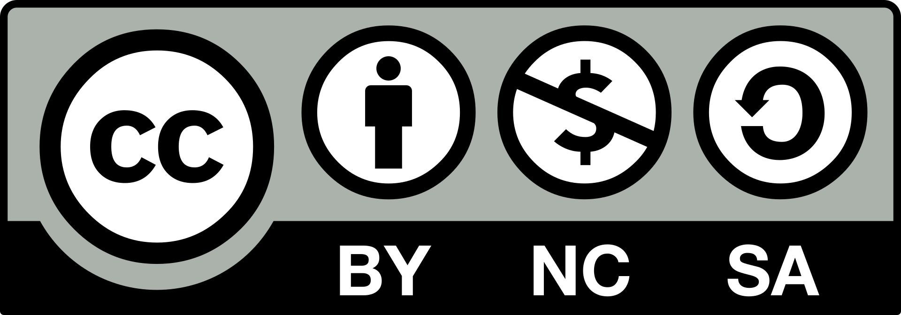

#+TITLE: La Placa Base
#+SUBTITLE: Sistemas Informáticos - CFGS Desarrollo de Aplicaciones Multiplataforma
#+AUTHOR: José Gaspar Sánchez García
#+email: jg.sanchezgarcia@edu.gva.es
#+DATE: \today

#+license: CC-BY-NC-SA-4.0

#+LANGUAGE: es
#+OPTIONS: H:2 toc:yes num:t

#+KEYWORDS: Placa base, socket, chipset, microprocesador, Intel, AMD.

# SPDX-License-Identifier: CC BY-NC-SA 4.0
# Copyright (c) 2026 José Gaspar Sánchez García

* Licencia
** Licencia
Este documento se distribuye bajo la licencia [[https://creativecommons.org/licenses/by-nc-sa/4.0/deed.es][Creative Commons Atribución 4.0 Internacional (CC BY-NC-SA 4.0)]].

* Prácticas Placa Base
** Hardware comercial: Placas bases y componentes
1. Busca  un  modelo  de  placa  base  actual,  analiza  sus  características,  en  especial  del chipset, y reúne toda la información técnica que puedas de la misma, así como de un microprocesador y memoria compatibles.
   Todas las placas base tienen un manual que suele llevar un cuadro resumen de sus características principales.
2. Realiza  un  estudio  sobre  procesadores  Intel  y  AMD  para  PC  tipo  workstation y para servidores (Intel Xeon, AMD Opteron / EPYC) en el que se analicen las características principales (núcleos, cache, componentes),  tecnologías de conexión (HyperTransport, DMI, etc.).
   Al menos un procesador para PC y otro para uso en servidores.
3. Una empresa requiere adquirir 30 equipos, 20 de tipo A (Workstation) y 10 de tipo B (portátiles), con los siguientes requisitos mínimos:
   + TIPO A
     + Formato ATX.
     + Procesador  de  al  menos  12  núcleos  en  total,  y  con  velocidad  superior  a  3,5 GHz un mínimo de 6 núcleos.
     + 32 GB memoria DDR5 5200MHz.
     + Disco duro SSD M.2 1 TBe. Disco duro 3,5” SATA3 4 TB.
     + Refrigeración líquida.
     + Tarjeta de red (LAN) Gigabit Ethernet.
     + Teclado y ratón óptico.
     + Sistema operativo Windows 11 profesional.
   + TIPO B
     + Ordenador portátil de 13” a 14”.
     + Procesador de i5 o i7 de generación 13.
     + 512 Gb SSDm.
     + Sistema operativo Windows 11 profesional.
     + Conexión USB tipo C.
   + Además, la empresa requiere de un equipo multifuncional, impresora y escáner laser color en formato A3 para trabajo en red.
     Realizar una oferta económica con vuestra elección del mercado desglosando precios en formato excel. 

* Práctica Propuesta:
** Práctica: identificación de una placa base

- *Módulo:* Hardware — Sistemas Informáticos (DAM)
- *Duración estimada:* 1–2 horas
- *Objetivo:* reconocer los componentes de una placa base y relacionarlos con sus funciones y compatibilidades.

** Material

- Un ordenador de sobremesa con la placa base accesible, *apagado y desconectado de la corriente*, o una imagen nítida de una placa base.
- Manual o página oficial del fabricante.
- Linterna y cámara, si se trabaja con hardware real.

> No desmontes componentes ni conectes o desconectes cables con el equipo enchufado. Descárgate de electricidad estática antes de tocar el interior.

** Actividades

*** 1. Identificación

Localiza y señala en una fotografía o esquema:

- Zócalo del procesador.
- Ranuras de memoria RAM.
- Ranuras PCI Express.
- Conectores SATA y M.2.
- Conector de alimentación ATX y alimentación de CPU.
- Chipset y disipadores.
- Pila CMOS.
- Conectores del panel trasero.
- Conectores del panel frontal de la caja.

*** 2. Ficha técnica

Busca el modelo exacto de la placa —normalmente aparece impreso sobre ella— y completa:

| Dato | Respuesta |
|---+---|
| Fabricante y modelo | |
| Factor de forma (ATX, microATX, Mini-ITX…) | |
| Socket del procesador | |
| Tipo y número de ranuras de RAM | |
| Capacidad máxima de RAM | |
| Ranuras PCIe | |
| Conectores SATA y M.2 | |
| Conexiones de vídeo, USB y red del panel trasero | |
| Versión de BIOS/UEFI consultada | |

Usa el manual o la ficha oficial del fabricante; no deduzcas los datos solo por el aspecto de la placa.

*** 3. Compatibilidad

Responde usando las especificaciones del modelo:

- ¿Qué procesadores son compatibles con el socket? ¿Hay que comprobar también la versión de BIOS?
- ¿Qué tipo de memoria RAM admite?
- ¿Qué formato de caja puede alojar la placa?
- ¿Qué unidades de almacenamiento se pueden conectar?
- ¿Qué tarjeta gráfica sería compatible con las ranuras disponibles?

*** 4. Panel trasero y conexiones

Dibuja o fotografía el panel trasero e identifica cada puerto. Indica para qué servirían, por ejemplo, los puertos USB, Ethernet, audio y las salidas de vídeo. Aclara que las salidas de vídeo de la placa solo funcionan si el procesador y la plataforma admiten gráficos integrados.

*** 5. Conclusión

Escribe un párrafo breve explicando qué función cumple la placa base y menciona dos decisiones de compra que dependen de ella, como el tipo de procesador, la RAM o el formato de la caja.

** Entrega

Un informe con la ficha técnica, la imagen anotada, las respuestas y la conclusión. Añade el enlace o referencia del manual consultado.

** Evaluación sugerida

- Identificación de componentes: *30 %*
- Ficha técnica correcta y basada en documentación: *30 %*
- Análisis de compatibilidad: *25 %*
- Presentación, seguridad y conclusiones: *15 %*
* Videos
- [[https://youtu.be/WTi5r9zAHz8][YouTube: Alejandro Cortés - La Placa Base.]]
* Enlaces web
- [[https://docs.google.com/document/d/12XYAc5sePJve56rX90AuEbEv6pnqMpOSvKXEcXA-wRA/edit?pli=1&tab=t.0]]
- https://www.educa2.madrid.org/web/dperezovejero/home/-/visor/ejercicios-de-hardware.
- [[https://dmc2vm44yioo9.cloudfront.net/5f74f63f-6d33-4b95-99e9-7bc593072351.pdf][Fundamentos del Hardware.]]
