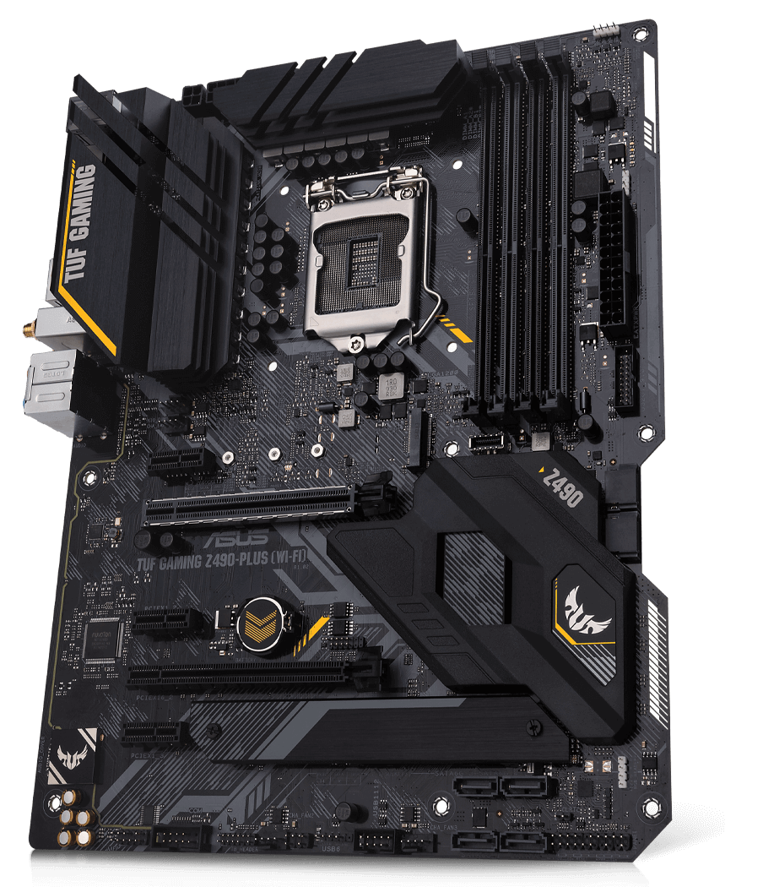

#+TITLE: La Placa Base
#+SUBTITLE: Sistemas Informáticos - CFGS Desarrollo de Aplicaciones Multiplataforma
#+AUTHOR: José Gaspar Sánchez García
#+email: jg.sanchezgarcia@edu.gva.es
#+DATE: \today

#+license: CC-BY-NC-SA-4.0

#+LANGUAGE: es
#+OPTIONS: H:2 toc:yes num:t

#+KEYWORDS: Placa base, socket, chipset, microprocesador, Intel, AMD.

# SPDX-License-Identifier: CC BY-NC-SA 4.0
# Copyright (c) 2026 José Gaspar Sánchez García

* Licencia
** Licencia
Este documento se distribuye bajo la licencia [[https://creativecommons.org/licenses/by-nc-sa/4.0/deed.es][Creative Commons Atribución 4.0 Internacional (CC BY-NC-SA 4.0)]].
[[./images/20260911-010143_1920px-Cc-by-nc-sa_icon.svg.png]]

* Prácticas Placa Base
** Hardware comercial: Placas bases y componentes
1. Busca  un  modelo  de  placa  base  actual,  analiza  sus  características,  en  especial  del chipset, y reúne toda la información técnica que puedas de la misma, así como de un microprocesador y memoria compatibles.
   Todas las placas base tienen un manual que suele llevar un cuadro resumen de sus características principales.
2. Realiza  un  estudio  sobre  procesadores  Intel  y  AMD  para  PC  tipo  workstation y para servidores (Intel Xeon, AMD Opteron / EPYC) en el que se analicen las características principales (núcleos, cache, componentes),  tecnologías de conexión (HyperTransport, DMI, etc.).
   Al menos un procesador para PC y otro para uso en servidores.
3. Una empresa requiere adquirir 30 equipos, 20 de tipo A (Workstation) y 10 de tipo B (portátiles), con los siguientes requisitos mínimos:
   + TIPO A
     + Formato ATX.
     + Procesador  de  al  menos  12  núcleos  en  total,  y  con  velocidad  superior  a  3,5 GHz un mínimo de 6 núcleos.
     + 32 GB memoria DDR5 5200MHz.
     + Disco duro SSD M.2 1 TBe. Disco duro 3,5” SATA3 4 TB.
     + Refrigeración líquida.
     + Tarjeta de red (LAN) Gigabit Ethernet.
     + Teclado y ratón óptico.
     + Sistema operativo Windows 11 profesional.
   + TIPO B
     + Ordenador portátil de 13” a 14”.
     + Procesador de i5 o i7 de generación 13.
     + 512 Gb SSDm.
     + Sistema operativo Windows 11 profesional.
     + Conexión USB tipo C.
   + Además, la empresa requiere de un equipo multifuncional, impresora y escáner laser color en formato A3 para trabajo en red.
     Realizar una oferta económica con vuestra elección del mercado desglosando precios en formato excel. 

* Práctica Propuesta:
** Práctica: identificación de una placa base

- *Módulo:* Hardware — Sistemas Informáticos (DAM)
- *Duración estimada:* 1–2 horas
- *Objetivo:* reconocer los componentes de una placa base y relacionarlos con sus funciones y compatibilidades.

** Material

- Un ordenador de sobremesa con la placa base accesible, *apagado y desconectado de la corriente*, o una imagen nítida de una placa base.
- Manual o página oficial del fabricante.
- Linterna y cámara, si se trabaja con hardware real.

> No desmontes componentes ni conectes o desconectes cables con el equipo enchufado. Descárgate de electricidad estática antes de tocar el interior.

** Actividades

*** 1. Identificación

Localiza y señala en una fotografía o esquema:

- Zócalo del procesador.
- Ranuras de memoria RAM.
- Ranuras PCI Express.
- Conectores SATA y M.2.
- Conector de alimentación ATX y alimentación de CPU.
- Chipset y disipadores.
- Pila CMOS.
- Conectores del panel trasero.
- Conectores del panel frontal de la caja.

*** 2. Ficha técnica

Busca el modelo exacto de la placa —normalmente aparece impreso sobre ella— y completa:

| Dato | Respuesta |
|---+---|
| Fabricante y modelo | |
| Factor de forma (ATX, microATX, Mini-ITX…) | |
| Socket del procesador | |
| Tipo y número de ranuras de RAM | |
| Capacidad máxima de RAM | |
| Ranuras PCIe | |
| Conectores SATA y M.2 | |
| Conexiones de vídeo, USB y red del panel trasero | |
| Versión de BIOS/UEFI consultada | |

Usa el manual o la ficha oficial del fabricante; no deduzcas los datos solo por el aspecto de la placa.

*** 3. Compatibilidad

Responde usando las especificaciones del modelo:

- ¿Qué procesadores son compatibles con el socket? ¿Hay que comprobar también la versión de BIOS?
- ¿Qué tipo de memoria RAM admite?
- ¿Qué formato de caja puede alojar la placa?
- ¿Qué unidades de almacenamiento se pueden conectar?
- ¿Qué tarjeta gráfica sería compatible con las ranuras disponibles?

*** 4. Panel trasero y conexiones

Dibuja o fotografía el panel trasero e identifica cada puerto. Indica para qué servirían, por ejemplo, los puertos USB, Ethernet, audio y las salidas de vídeo. Aclara que las salidas de vídeo de la placa solo funcionan si el procesador y la plataforma admiten gráficos integrados.

*** 5. Conclusión

Escribe un párrafo breve explicando qué función cumple la placa base y menciona dos decisiones de compra que dependen de ella, como el tipo de procesador, la RAM o el formato de la caja.

** Entrega

Un informe con la ficha técnica, la imagen anotada, las respuestas y la conclusión. Añade el enlace o referencia del manual consultado.

** Evaluación sugerida

- Identificación de componentes: *30 %*
- Ficha técnica correcta y basada en documentación: *30 %*
- Análisis de compatibilidad: *25 %*
- Presentación, seguridad y conclusiones: *15 %*

* Práctica propuesta 3: Montaje y comprobación de un computador
** Identificación de las tareas
**Módulo:** Sistemas Informáticos — CFGS Desarrollo de Aplicaciones Multiplataforma  
**Duración estimada:** 3–4 horas  
**Modalidad:** Parejas o grupos de tres  
**Producto final:** Equipo montado, funcional y documentado.

** Objetivos

Al finalizar la práctica, el alumnado será capaz de:

- Identificar la placa base, sus componentes y conectores principales.
- Instalar los componentes internos en la carcasa siguiendo un orden seguro.
- Conectar la alimentación, el panel frontal y los puertos de la carcasa.
- Comprobar el arranque y diagnosticar errores básicos de montaje.

** Material necesario

- Carcasa, placa base, procesador con disipador, memoria RAM y fuente de alimentación.
- Unidad SSD o HDD y, si está disponible, tarjeta gráfica.
- Tornillos, separadores de placa y manuales de los componentes.
- Destornillador, pulsera antiestática o medidas de descarga electrostática.
- Monitor, teclado y cable de alimentación.

** Desarrollo

1. **Inspección y planificación**
   - Revisad los componentes y consultad los manuales de la placa base y la carcasa.
   - Localizad el zócalo del procesador, ranuras RAM, conectores de almacenamiento, alimentación y panel frontal.
   - Elaborad un esquema sencillo del montaje previsto.

2. **Preparación de la placa base**
   - Colocad el procesador sin forzar el zócalo.
   - Instalad el disipador y conectad su ventilador al conector correspondiente.
   - Insertad la memoria RAM en las ranuras recomendadas por el manual.
   - Si procede, instalad la unidad M.2.

3. **Montaje en la carcasa**
   - Comprobad la posición de los separadores y colocad el embellecedor trasero de puertos, si es independiente.
   - Fijad la placa base a la carcasa sin apretar excesivamente los tornillos.
   - Instalad la fuente de alimentación y conectad la alimentación principal de la placa y la del procesador.
   - Montad la unidad SSD/HDD y conectad sus cables de datos y alimentación.
   - Instalad la tarjeta gráfica, si está disponible.

4. **Conexiones de la carcasa**
   - Conectad los cables del botón de encendido, reinicio y LED según el esquema del manual.
   - Conectad los puertos USB y audio frontales.
   - Organizad los cables para que no obstruyan los ventiladores.

5. **Identificación de puertos**
   - Identificad y etiquetad los puertos traseros de la placa base y los puertos frontales de la carcasa.
   - Indicad la función de cada puerto y qué dispositivo se podría conectar.
   - Diferenciad los conectores externos de los conectores internos de la placa base.

6. **Comprobación**
   - Antes de encender, revisad que no haya tornillos sueltos ni cables en contacto con los ventiladores.
   - Conectad monitor, teclado y alimentación.
   - Encended el equipo y comprobad que aparece la pantalla de inicio o se accede a la BIOS/UEFI.
   - Si no arranca, aplicad una revisión ordenada: alimentación, RAM, conexiones del panel frontal y señales acústicas o luminosas.

** Entrega

Cada grupo entregará:

- Fotografías del montaje en tres fases: placa preparada, equipo montado y equipo encendido.
- Un esquema con los componentes instalados y sus conexiones principales.
- Una tabla de puertos identificados con su función.
- Una breve incidencia encontrada —o indicar que no hubo ninguna— y cómo se resolvió o se comprobaría.
- Una lista de comprobación final firmada por el grupo.

** Evaluación

| Criterio                                                  | Puntuación |
|-----------------------------------------------------------+------------|
| Identificación de la placa base, componentes y conectores | 20 %       |
| Montaje correcto y manipulación segura de los componentes | 30 %       |
| Conexión del panel frontal, alimentación y puertos        | 20 %       |
| Comprobación del arranque y diagnóstico básico            | 15 %       |
| Documentación clara y trabajo en equipo                   | 15 %       |

**Seguridad:** manipulad los componentes con el equipo desconectado, evitad tocar los contactos eléctricos y no forcéis ninguna pieza. Si una conexión no encaja, consultad el manual antes de continuar.
  

* Placas Base
** Socket AM4
*** MSI MPG B550 GAMING PLUS 
*** Placa base Gigabyte B550M DS3H R2 AM4 Micro ATX, DDR4, Dual M.2, 128GB, LAN 1GbE
*** Gigabyte A520M K V2
*** MSI B550M PRO-VDH WIFI 
*** Asus Prime B450M-K II
*** Placa Base ASUS TUF Gaming B550-PLUS WiFi II B550 AM4 DDR4 ATX WiFi 6 Dual M.2 RGB
#+DOWNLOADED: https://www.asus.com/websites/global/products/dvy2c3hgqjvmpugy/img/kv/x570.png @ 2026-10-27 13:34:04

** Socket AM5
*** Placa Base MSI PRO B850-S WIFI6E ATX AM5 PRO DDR5 M.2 Dual LAN RGB
*** ASUS TUF GAMING B850-PLUS WIFI
*** MSI B850 GAMING PLUS WIFI6E placa base AMD B850 Zócalo AM5 ATX
*** Gigabyte B650 EAGLE AX
*** MSI B850M GAMING PLUS WIFI
*** MSI X870E GAMING PLUS WIFI
*** ASUS ROG STRIX B850-E GAMING WIFI
*** GIGABYTE X870 AORUS ELITE WIF7 ICE
*** Placa Base Gigabyte B650 ATX AM5 B650 EAGLE DDR5 PCIe 5.0 USB 3.2 Gen2 LAN GbE
*** Placa Base MSI MAG B850 Tomahawk Wifi AM5 DDR5 ATX WiFi 7 5G LAN Triple M.2 PCIe 5.0
*** MSI MPG X870E CARBON WIFI
*** ASUS ProArt X870E-CREATOR WIFI
** Socket Intel LGA 1200
*** Placa Base Biostar TZ590-BTC Intel Z590 LGA 1200 DDR4 ATX HDMI VGA Gigabit
*** Placa Base ASUS Intel ATX LGA 1200 P12R-E DDR4 128GB M.2 SATA III AST2600 Servidor

** Socket Intel LGA 1700

*** ASUS Prime B760M-A D4-CSM
*** Placa Base MSI B760 GAMING PLUS WIFI Intel B760 LGA1700 DDR4 ATX WiFi 6 PCIe 4.0
*** MSI PRO H610M-E DDR4
*** Gigabyte B760M D3HP DDR4
*** ASUS Prime B760-PLUS D4
*** ASUS Prime B760M-A WIFI D4
*** Placa Base GIGABYTE B760 GAMING X Intel B760 LGA1700 DDR4 ATX 2.5GbE PCIe 5.0 RGB
*** MSI PRO B760-P WIFI DDR4

** Socket Intel LGA 1851

*** Placa Base MSI MPG Z890 CARBON WIFI Z890 LGA1851 DDR5 ATX WiFi 7 Thunderbolt 4 RGB
*** ASUS TUF GAMING Z890-PRO WIFI
*** Gigabyte Z890 AORUS PRO ICE
*** Gigabyte Z890 GAMING X WIFI7
*** ASUS PRIME Z890-P
*** MSI MPG Z890 EDGE TI WIFI
*** Placa Base ASRock H810M-X WiFi Intel H810

**** Presupuesto

| Componentes base            | Descripción | Unidades | Precio/Unidad | Precio |
|-----------------------------+-------------+----------+---------------+--------|
| Placa base                  |             |        1 |               |      0 |
| Microprocesador             |             |        1 |               |      0 |
| Memoria RAM                 |             |        4 |               |      0 |
| Refrigeración               |             |        1 |               |      0 |
| Fuente de alimentación      |             |          |               |      0 |
| Gráfica                     |             |          |               |      0 |
| TARJETA SONIDO              |             |          |               |      0 |
| LECTOR TARJETAS/FRONTAL     |             |          |               |      0 |
| GRABADORA DVD               |             |          |               |      0 |
| VENTILADORES SUPLEMENTARIOS |             |          |               |      0 |
| ADAPTADOR RED/WIFI          |             |          |               |      0 |
| MONITOR                     |             |          |               |      0 |
| TECLADO                     |             |          |               |      0 |
| RATÓN                       |             |          |               |      0 |
| AURICULARES / ALTAVOCES     |             |          |               |      0 |
| MICRÓFONOS                  |             |          |               |      0 |
|-----------------------------+-------------+----------+---------------+--------|
|                             |             |        7 | Precio total: |      0 |
#+TBLFM: $5=$3*$4::@18$3=vsum(@2..@17)::@18$5=vsum(@2..@17)
* Videos
- [[https://youtu.be/WTi5r9zAHz8][YouTube: Alejandro Cortés - La Placa Base.]]
* Enlaces web
- [[https://docs.google.com/document/d/12XYAc5sePJve56rX90AuEbEv6pnqMpOSvKXEcXA-wRA/edit?pli=1&tab=t.0]]
- https://www.educa2.madrid.org/web/dperezovejero/home/-/visor/ejercicios-de-hardware.
- [[https://dmc2vm44yioo9.cloudfront.net/5f74f63f-6d33-4b95-99e9-7bc593072351.pdf][Fundamentos del Hardware.]]
